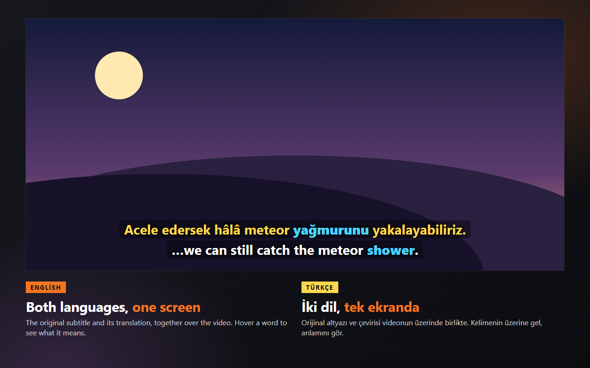
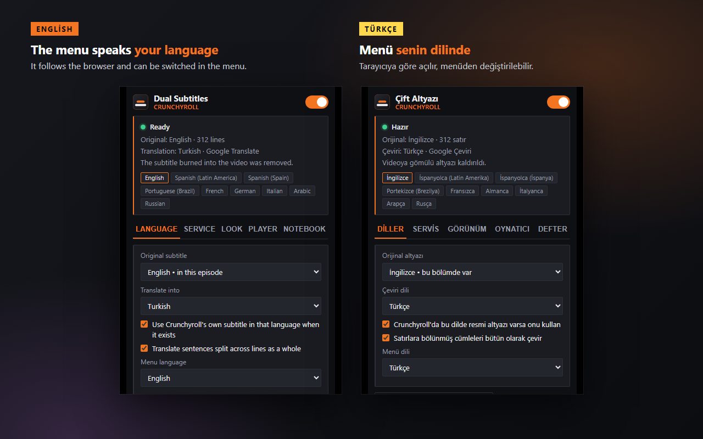

# SubTranslate — Dual Subtitles for Crunchyroll

A Chrome extension that shows the **original Crunchyroll subtitle and its translation at the same time**, as two lines over the video — for watching a show in a language your Crunchyroll account has no subtitles for.

**Version 1.0.7** — the same code that is published on the [Chrome Web Store](https://chromewebstore.google.com/detail/dual-subtitles-for-crunch/dokkeifgjdekkeacknhhhkdhmpiooaek). Every release is tagged here, and what changed in each one is in the [changelog](CHANGELOG.md).

## What it does

- **Two lines at once:** the original subtitle and its translation into the language you pick.
- **Your choice of service:** Google Translate (free, no key), DeepL, Google Gemini or Anthropic Claude with your own API key. If a key or quota runs out mid-episode, the rest is finished with Google Translate instead of stopping.
- **Word lookup:** hover a word to see two meanings of it and which word carries it in the translation.
- **Word notebook:** click that word to file it with its part of speech, the sentence it came from, an example and the episode. Exports as an Anki deck, CSV or JSON.
- **Interface in six languages** — English, Turkish, German, Spanish, Brazilian Portuguese and French — following the browser and switchable in the menu.

## Install

The extension lives in [`extension/`](extension/). To run it from source: open `chrome://extensions`, turn on Developer mode, press **Load unpacked** and pick that folder.

Everything else — features, settings, how it reads the player, troubleshooting — is in the [extension's README](extension/README.md).

## Privacy

Subtitle text is sent only to the translation service you select; nothing goes to the developer, and there is no analytics or tracking code. API keys stay in your browser. The full policy, in English and Turkish, is at [privacy-policy.html](https://yabq.github.io/SubTranslate/privacy-policy.html).

## Licence

[GNU General Public License v3.0](LICENSE). You may use, study, change and share this code; anything you build on it has to stay under the same licence and stay open.

The bundled Anthropic SDK under `extension/src/background/vendor/` is third-party code and keeps its own MIT licence, in `anthropic-sdk.LICENSE.txt` beside it.

## Notes

This extension is not affiliated with or endorsed by Crunchyroll. Crunchyroll is a trademark of Crunchyroll, LLC. You need the right to watch the episode; the extension does not download video, it only draws subtitles.
